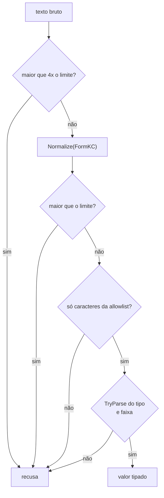

# Validação de entrada: o contrato no DI, o tipo certo e o errado x certo de XSS e SQL injection

> Vídeo: (link em breve)

Toda entrada que chega de fora (formulário, query string, JSON, fila) é texto até provar o contrário. Este exemplo
mostra uma arquitetura pequena em que **um serviço só conhece o contrato** `IValidadorDeEntrada`, e a implementação
faz, nesta ordem: limite bruto → normalização NFKC → limite depois de normalizar → allowlist de caracteres →
tipo com `TryParse` → faixa. Depois mostra por que isso **não basta**: o texto válido ainda precisa de encoding na
saída (XSS) e a consulta ainda precisa de parâmetro (SQL injection).

> **Teste local e defensivo.** Clientes fictícios, SQLite em memória, nada sai da máquina. Veja
> [seguranca-didatica.md](../seguranca-didatica.md).

| | |
|---|---|
| Biblioteca | [`src/Enneal.Algoritmos.ValidacaoEntrada`](../../src/Enneal.Algoritmos.ValidacaoEntrada) |
| Exemplo | [`samples/validacao-de-entrada`](../../samples/validacao-de-entrada) (README com a explicação de cada passo e as fontes) |
| Testes | [`tests/Enneal.Algoritmos.ValidacaoEntrada.Tests`](../../tests/Enneal.Algoritmos.ValidacaoEntrada.Tests) |
| Roteiro do vídeo | [`roteiro-video.md`](../../samples/validacao-de-entrada/roteiro-video.md) |

## Como funciona

## Como se defender

| Faça | Evite |
|------|-------|
| Valide no servidor, por campo, com allowlist (tipo, formato, faixa, tamanho) | listas de "palavras perigosas" e remover caracteres "suspeitos" |
| Converta com `TryParse`, `NumberStyles` restrito e `CultureInfo.InvariantCulture` | `Convert.ToInt32` com try/catch, cultura do servidor, regex caseira para número ou e-mail |
| Normalize antes de validar e use a forma normalizada dali em diante | validar uma forma e gravar ou exibir outra |
| Codifique na saída conforme o contexto (`HtmlEncoder`, Razor já codifica) | `Html.Raw`, `MarkupString` ou montar HTML com interpolação |
| Use consulta parametrizada (ou um ORM que parametriza) | concatenar ou interpolar texto do usuário no SQL |
| Confirme e-mail mandando um link | achar que o formato prova que a caixa existe |

## Fontes

- OWASP, [Input Validation Cheat Sheet](https://cheatsheetseries.owasp.org/cheatsheets/Input_Validation_Cheat_Sheet.html)
- OWASP, [Cross Site Scripting Prevention Cheat Sheet](https://cheatsheetseries.owasp.org/cheatsheets/Cross_Site_Scripting_Prevention_Cheat_Sheet.html)
- OWASP, [SQL Injection Prevention Cheat Sheet](https://cheatsheetseries.owasp.org/cheatsheets/SQL_Injection_Prevention_Cheat_Sheet.html)
- Microsoft, [Injeção de dependência no .NET](https://learn.microsoft.com/pt-br/dotnet/core/extensions/dependency-injection)
- Microsoft, [Prevent Cross-Site Scripting (XSS) in ASP.NET Core](https://learn.microsoft.com/en-us/aspnet/core/security/cross-site-scripting)
- Microsoft, [Parâmetros no Microsoft.Data.Sqlite](https://learn.microsoft.com/en-us/dotnet/standard/data/sqlite/parameters)
- Unicode, [UAX #15: Unicode Normalization Forms](https://unicode.org/reports/tr15/)
