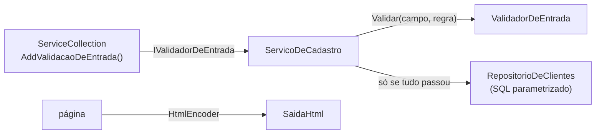

Português | [English](README.en.md)

# Validação de entrada em C#: o contrato no DI, o tipo certo e o errado x certo de XSS e SQL injection

Um formulário de cadastro recebe 7 entradas, 6 delas maliciosas ou inválidas. O serviço não sabe validar: ele
recebe o contrato `IValidadorDeEntrada` pela injeção de dependência. O validador detecta e confere o tipo com
`TryParse` (sem regex), normaliza o Unicode, limita o tamanho e só aceita caracteres de uma allowlist. Depois, o
mesmo texto é colado no HTML (errado) e codificado com `HtmlEncoder` (certo), e a mesma busca vai concatenada no SQL
(errado, 4 linhas vazadas) e parametrizada (certo, 0 linhas).

> **Teste local e defensivo.** Os clientes são fictícios, o banco é um SQLite em memória criado pelo próprio
> programa e nada sai da máquina. Validação reduz o risco, não o elimina: ela não substitui a consulta
> parametrizada, o encoding de saída nem a checagem de permissão.

Vídeo: (link em breve) · Roteiro narrado: [`roteiro-video.md`](roteiro-video.md)

## Como rodar

Precisa do [.NET 8 SDK](https://dotnet.microsoft.com/download) (grátis).

```bash
cd samples/validacao-de-entrada
dotnet run
```

## Saída esperada

```
DI: IValidadorDeEntrada -> ValidadorDeEntrada

Detectar o tipo:
  42                     -> Inteiro
  -7                     -> Inteiro
  19.90                  -> Decimal
  2026-10-23             -> Data
  ana@exemplo.example    -> Email
  1e9                    -> Texto
  0x1F                   -> Texto
  2026-02-30             -> Texto
  Olá, mundo             -> Texto

Cadastro:
  válido               -> gravado (id 4)
  idade com SQL        -> recusado: idade: mais de 3 caracteres
  idade negativa       -> recusado: idade: fora da faixa
  e-mail com nome      -> recusado: email: e-mail inválido
  data impossível      -> recusado: nascimento: data inválida (use aaaa-MM-dd)
  caractere invisível  -> recusado: nome: caractere não permitido
  nome gigante         -> recusado: nome: grande demais

XSS: "<script>alert(1)</script>" passa na validação de texto? sim
  errado: <p><script>alert(1)</script></p>
  certo:  <p>&lt;script&gt;alert(1)&lt;/script&gt;</p>
  disfarce "＜script＞" depois do NFKC: "<script>"

SQLi: buscar o nome "' OR '1'='1"
  errado (concatenado):   4 linhas
  certo  (parametrizado): 0 linhas
```

Este arquivo também está em [`saida-esperada.txt`](saida-esperada.txt), e os testes conferem que a saída continua
idêntica. (O id gravado é 4 porque o banco nasce com 3 clientes fictícios; a busca concatenada devolve 4 linhas
porque, nessa hora, a Ana já foi gravada.)

## A arquitetura, em 5 arquivos



| Arquivo | Papel |
|---------|-------|
| [`Contrato.cs`](../../src/Enneal.Algoritmos.ValidacaoEntrada/Contrato.cs) | `IValidadorDeEntrada`, `TipoDeDado`, `RegraDeCampo`, `ResultadoValidacao` |
| [`ValidadorDeEntrada.cs`](../../src/Enneal.Algoritmos.ValidacaoEntrada/ValidadorDeEntrada.cs) | a implementação: limite, NFKC, allowlist, `TryParse` por tipo, `DetectarTipo` |
| [`ServicoDeCadastro.cs`](../../src/Enneal.Algoritmos.ValidacaoEntrada/ServicoDeCadastro.cs) | recebe o contrato pelo construtor; grava só se todos os campos passarem |
| [`RepositorioDeClientes.cs`](../../src/Enneal.Algoritmos.ValidacaoEntrada/RepositorioDeClientes.cs) | a mesma busca concatenada (errado) e parametrizada (certo) |
| [`SaidaHtml.cs`](../../src/Enneal.Algoritmos.ValidacaoEntrada/SaidaHtml.cs) | o mesmo texto colado (errado) e codificado com `HtmlEncoder` (certo) |
| [`RegistroNoDi.cs`](../../src/Enneal.Algoritmos.ValidacaoEntrada/RegistroNoDi.cs) | `AddValidacaoDeEntrada()`: registra o contrato e quem o consome |

## Por que cada passo

| Passo | O que o código faz | Por quê |
|-------|--------------------|---------|
| Contrato no DI | o serviço recebe `IValidadorDeEntrada`, não `new ValidadorDeEntrada()` | a regra fica num lugar só; nos testes, um validador falso prova que o serviço depende só do contrato |
| Limite bruto | recusa antes de normalizar o que passa de 4x o máximo do campo | o OWASP pede limite de tamanho **antes** de processar a entrada, para não gastar recurso com o que será recusado |
| Normalização NFKC | `"＜script＞"` vira `"<script>"`, `"３４"` vira `"34"`, `é` composto e decomposto ficam iguais | validar o disfarce e usar a forma canônica depois deixa a checagem para trás. O OWASP lembra que a normalização de compatibilidade pode apagar diferenças: aqui ela é a política escolhida para estes campos |
| Limite depois | o tamanho vale para o texto já normalizado | a normalização pode aumentar o texto (o teste usa um caractere que vira 18) |
| Allowlist de caracteres | letras, marcas, números, pontuação, símbolos e o espaço comum | o OWASP prefere dizer o que é aceito a tentar listar todo ataque. Sai o `U+202E` (inverte o texto), o espaço de largura zero, o byte nulo e a quebra de linha. O apóstrofo de `O'Brien` fica |
| Tipo com `TryParse` | `int`/`decimal` com `NumberStyles` restrito e cultura invariante; data `aaaa-MM-dd` exata; e-mail com `MailAddress.TryCreate` | parser mantido em vez de regex frágil: `1e9`, `0x1F`, `1,000`, `2026-02-30` e `"Davi" <davi@...>` são recusados |
| Faixa | idade de 0 a 130 | converter para `int` só prova o tipo, não que o valor faz sentido |
| Encoding de saída | `HtmlEncoder.Default.Encode` | texto válido pode ter `<`: a defesa contra XSS é codificar **na saída**, conforme o contexto |
| SQL parametrizado | `WHERE nome = $nome` + `AddWithValue` | com parâmetro, a entrada é sempre dado e nunca código; validação sozinha não protege a consulta |

> **Por que `InvariantGlobalization` está desligado aqui.** O resto do repositório usa o modo invariante, e nesse
> modo o .NET não tem os dados de normalização: o `Normalize` devolve o texto sem mudar nada. O validador confere
> isso no construtor e **se recusa a nascer** (falha fechada) em vez de validar sem normalizar. Por isso este exemplo
> e o projeto de testes dele desligam o modo invariante.

## Testes

[`tests/Enneal.Algoritmos.ValidacaoEntrada.Tests`](../../tests/Enneal.Algoritmos.ValidacaoEntrada.Tests): 82 testes
xUnit com os casos maliciosos (SQL na idade, `1e2`, `NaN`, e-mail com nome de exibição e com quebra de linha, data
impossível, `U+202E`, byte nulo, substituto solto, texto que cresce ao normalizar, ``, `' UNION SELECT`),
a troca do validador por um falso e a saída deste exemplo.

```bash
dotnet test
```

## Fontes

- OWASP, [Input Validation Cheat Sheet](https://cheatsheetseries.owasp.org/cheatsheets/Input_Validation_Cheat_Sheet.html): allowlist, limite antes de processar, parser mantido, Unicode, e-mail e armadilhas
- OWASP, [Cross Site Scripting Prevention Cheat Sheet](https://cheatsheetseries.owasp.org/cheatsheets/Cross_Site_Scripting_Prevention_Cheat_Sheet.html) e [SQL Injection Prevention Cheat Sheet](https://cheatsheetseries.owasp.org/cheatsheets/SQL_Injection_Prevention_Cheat_Sheet.html)
- OWASP Top 10 2021, [A03 Injection](https://owasp.org/Top10/A03_2021-Injection/)
- Microsoft, [Injeção de dependência no .NET](https://learn.microsoft.com/pt-br/dotnet/core/extensions/dependency-injection)
- Microsoft, [Prevent Cross-Site Scripting (XSS) in ASP.NET Core](https://learn.microsoft.com/en-us/aspnet/core/security/cross-site-scripting) e [`HtmlEncoder`](https://learn.microsoft.com/en-us/dotnet/api/system.text.encodings.web.htmlencoder)
- Microsoft, [Parâmetros no Microsoft.Data.Sqlite](https://learn.microsoft.com/en-us/dotnet/standard/data/sqlite/parameters)
- Microsoft, [`String.Normalize`](https://learn.microsoft.com/en-us/dotnet/api/system.string.normalize) e [`MailAddress.TryCreate`](https://learn.microsoft.com/en-us/dotnet/api/system.net.mail.mailaddress.trycreate)
- .NET runtime, [Globalization invariant mode](https://github.com/dotnet/runtime/blob/main/docs/design/features/globalization-invariant-mode.md) (seção *String normalization*)
- Unicode, [UAX #15: Unicode Normalization Forms](https://unicode.org/reports/tr15/)
